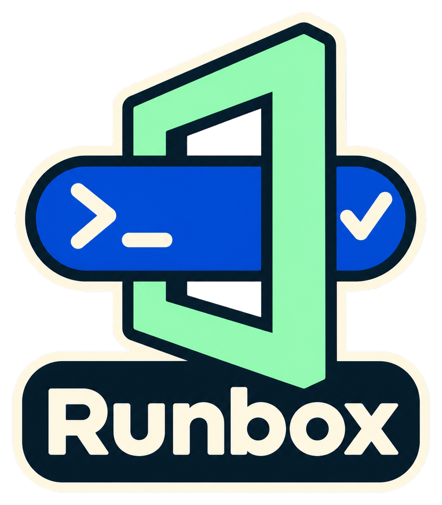

<p align="center">
  
  <br>
<!-- repo-tagline:start -->
<strong>📦 One command for reviewed access and execution 🔐</strong>
<!-- repo-tagline:end -->
</p>

# Runbox

Run commands with the access settings a repository declares, using a secret
provider without building another launcher into every project.

```sh
runbox check
runbox run -- your-command --your-options
```

Runbox reads `.runbox.yaml` from the Git root, including when called from a
subdirectory. Named profiles describe the provider, public placeholders, session
limits and execution policy. Machine paths and integrity approvals stay outside
the repository. Configuration changes require explicit local review before a
command can use them.

The first provider is **Infisical Agent Vault**. It creates the scoped session,
proxies requests and revokes the session on exit. Runbox supplies explicit native
CLI options; it does not retrieve service keys, implement a credential proxy or
refresh credentials. The existing token broker remains a separate administrator
tool.

## Install from source

Requires Python 3.11+, `uv`, Git and a separately installed, checksum-verified
Infisical CLI. Use an authenticated repository URL when access requires it.

```sh
git clone https://github.com/tsilva/runbox.git
cd runbox
uv --no-config sync --locked --exclude-newer '7 days'
uv --no-config run --locked --exclude-newer '7 days' python scripts/build.py
uv --no-config run --locked --exclude-newer '7 days' python scripts/install.py --python /absolute/persistent/python3
runbox --version
```

Choose a persistent Python executable rather than a disposable build environment.
The installer adds an owner-only release and a `runbox` link in `~/.local/bin`;
that directory must already be on your PATH. It refuses to replace an unrelated
command and leaves existing launchers installed. This project is installed from
its repository; the unrelated PyPI package named `runbox` is not this tool.

## Configure and approve a repository

Start with [the configuration guide](docs/configuration.md) and
[the example](examples/runbox.yaml). Review the exact service scope, public CA,
native CLI and client compatibility. Keep real credentials out of both the
repository YAML and the machine runtime file.

```sh
runbox approve --runtime /absolute/private/runtime.json
runbox check
runbox run -- your-command --help
```

`approve` records the reviewed configuration, runtime and source hashes. It is
an explicit administrative action, never something `run` does after a failed
check. A copied repository, new worktree or changed source needs its own review.

## Execution policies

The `none` policy supports ordinary or fixed, integrity-checked commands that
honor native HTTP proxy settings. It adds no operating-system isolation and is
never a fallback for a profile that requires a sandbox.

The initial `macos-staging` policy retains a stricter Python workflow: one
approved console command, exact HTTP routes, read-only source, isolated HOME,
staging-only writes and proxy-only network access. It requires macOS's
`sandbox-exec`; unsupported hosts fail explicitly. Full-access host processes
and trusted setup are outside this child boundary.

Changing provider adapters does not change these execution policies. Additional
providers and sandbox backends can be implemented independently. The additional
`macos-command` policy compiles reviewed filesystem, executable and network rules
from data. Shared Python and Node clients replace duplicated launchers; optional
local-service coordination, delegated sessions and provider-local app handoffs
preserve existing setups. See [execution policies](docs/execution.md).

Runbox is optional tooling for a contributor's access setup. A consumer's normal
commands should work with its ordinary environment without installing Runbox.
Existing callers can use command links to the identical shared runner, backed by
owner-reviewed metadata rather than copied wrapper scripts.

See [migration](docs/migration.md) for fleet cutover and the archived Repologogen pilot, and
[development](docs/development.md) for reproducible verification and limitations.

## License

[MIT](LICENSE). The standalone archive includes PyYAML's license.

For global agent discovery rules and external invocation, see [agent integration](docs/agents.md).
